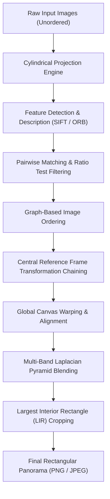

# Panorama Reconstruction & Image Stitching System
## Comprehensive Technical & Architectural Documentation

---

## 1. Executive Summary

The **Panorama Reconstruction & Image Stitching System** is an end-to-end computer vision software suite built with Python, OpenCV, and Streamlit. The system takes multiple overlapping photographs of a scene—captured with varying orientations, resolutions, angles, and in arbitrary upload orders—and combines them into a single, seamless, high-resolution panoramic image.

### Key Capabilities
- **Distortion-Free Geometric Alignment**: Employs **Cylindrical Projection** coupled with **Rigid / Affine RANSAC estimation** to eliminate the classical "wedge/trumpet" perspective divergence, guaranteeing uniform height and width across the entire panorama.
- **Arbitrary Input Order Handling**: Utilizes a graph-based greedy expansion algorithm based on pairwise feature correspondence to automatically reconstruct the true spatial ordering (e.g., Left-to-Right).
- **Center-Referenced Coordinate Frame**: Anchors the global projection canvas to the sequence's central image ($H_{\text{ref}} = I$), symmetrically distributing alignment tolerances and preventing error compounding.
- **Seam-Free Multi-Band Blending**: Implements Burt-Adelson Laplacian pyramid blending to decompose spatial frequencies, blending illumination and high-frequency textures independently to eliminate visible seams and ghosting.
- **Automated Rectangular Bounding**: Features an $O(W \cdot H)$ stack-based histogram algorithm to locate and crop the largest fully-valid interior rectangle, eliminating jagged black canvas edges.
- **Interactive Web Interface**: A Streamlit frontend offering 1-click sample datasets, live progress tracking, feature match inspection, intermediate step visualization, and inlier heatmaps.

---

## 2. System Architecture & Pipeline Workflow

The processing pipeline is structured modularly:



### End-to-End Processing Stages

| Stage | Module | Primary Operation |
|---|---|---|
| **1. Projection** | `stitcher/cylindrical.py` | Cylindrical coordinate mapping based on focal length estimation |
| **2. Feature Detection** | `stitcher/feature_detector.py` | Scale-space extrema detection (SIFT) or FAST corners (ORB) |
| **3. Correspondence** | `stitcher/feature_matcher.py` | FLANN / BFMatcher with Lowe's ratio distance filtering |
| **4. Ordering** | `stitcher/ordering.py` | Adjacency matrix construction and greedy Hamiltonian path traversal |
| **5. Alignment** | `stitcher/homography.py` | RANSAC-driven Affine / Similarity transformation estimation |
| **6. Reference Chaining** | `stitcher/pipeline.py` | Centroid-referenced outward matrix propagation |
| **7. Blending** | `stitcher/warper.py` | Multi-image unified canvas warping and Laplacian pyramid fusion |
| **8. Cropping** | `stitcher/rect_crop.py` | Stack-based largest zero-free rectangle identification |
| **9. Presentation** | `app.py` | Streamlit rendering, match overlays, inlier heatmaps, download packaging |

---

## 3. Mathematical & Algorithmic Foundations

### 3.1 Cylindrical Projection
When a camera pans around its optical center to capture a panorama, points in 3D space undergo rotation. Projecting these images directly onto a flat planar canvas causes extreme stretching toward the horizontal periphery. 

Mapping image coordinates $(x, y)$ onto a cylinder of radius $f$ (where $f$ is the focal length in pixels) converts panning rotation into pure horizontal translation:

$$\theta = \frac{x - c_x}{f}, \quad h = \frac{y - c_y}{f}$$

The inverse mapping used for bilinear interpolation (`cv2.remap`) is:

$$x_{\text{src}} = f \cdot \tan\left(\frac{x_{\text{cyl}} - c_x}{f}\right) + c_x$$

$$y_{\text{src}} = \frac{y_{\text{cyl}} - c_y}{\cos\left(\frac{x_{\text{cyl}} - c_x}{f}\right)} + c_y$$

where $(c_x, c_y) = \left(\frac{W}{2}, \frac{H}{2}\right)$ is the principal point. The focal length $f$ is automatically derived from the horizontal Field-of-View (FOV):

$$f = \frac{W}{2 \cdot \tan\left(\frac{\text{FOV}}{2}\right)}$$

---

### 3.2 The Wedge Effect: Why 8-DOF Homography Fails vs. Affine Alignment

#### The Failure of Chained Projective Homographies
A standard projective planar homography $H \in \mathbb{R}^{3 \times 3}$ operates as:

$$\begin{bmatrix} x' \\ y' \\ 1 \end{bmatrix} \sim \begin{bmatrix} h_{00} & h_{01} & h_{02} \\ h_{10} & h_{11} & h_{12} \\ h_{20} & h_{21} & 1 \end{bmatrix} \begin{bmatrix} x \\ y \\ 1 \end{bmatrix}$$

$$x' = \frac{h_{00}x + h_{01}y + h_{02}}{h_{20}x + h_{21}y + 1}, \quad y' = \frac{h_{10}x + h_{11}y + h_{12}}{h_{20}x + h_{21}y + 1}$$

When multiple images are stitched sequentially, the cumulative transformation is $H_{\text{total}} = H_1 \cdot H_2 \cdot H_3 \cdots$. Even tiny non-zero values in the perspective division row $[h_{20}, h_{21}]$ (e.g., $1.6 \times 10^{-4}$) compound exponentially. For large coordinate values $x > 1500$, the denominator diverges or approaches zero:
- Vertical lines slant outward.
- Heights expand from $682\text{ px}$ to over $4000\text{ px}$.
- The canvas takes on a **trapezoidal "wedge" or "trumpet" flare**.

#### The Affine / Rigid Transformation Guarantee
Once images are projected onto a cylinder, the geometric transformation between adjacent frames captured by panning is **pure 2D rigid motion** (translation + minor tilt rotation + scale):

$$M_{\text{affine}} = \begin{bmatrix} s \cos\theta & -s \sin\theta & t_x \\ s \sin\theta & s \cos\theta & t_y \\ 0 & 0 & 1 \end{bmatrix}$$

Because the bottom row is strictly $[0, 0, 1]$, the denominator is identically $1$:

$$y' = s \sin\theta \cdot x + s \cos\theta \cdot y + t_y$$

Parallel lines remain parallel, scale remains bounded ($s \approx 1.0$), and the height of the panorama remains **strictly uniform from the left edge to the right edge**.

---

### 3.3 Feature Detection & Description
- **SIFT (Scale-Invariant Feature Transform)**:
  - Detects keypoints across scale-space octaves using Difference-of-Gaussians ($\text{DoG} = G(x,y,k\sigma) - G(x,y,\sigma)$).
  - Assigns orientation based on local image gradient directions.
  - Constructs a 128-dimensional feature vector robust to illumination, scale, and rotation.
- **ORB (Oriented FAST and Rotated BRIEF)**:
  - Uses FAST corner detection with an image pyramid for multi-scale response.
  - Computes intensity centroids to assign corner orientation.
  - Generates a 256-bit binary descriptor compared using Hamming distance.

---

### 3.4 Feature Matching & Lowe's Ratio Test
For each descriptor $d_i$ in Image A, the two nearest neighbors $n_1$ and $n_2$ in Image B are identified via Euclidean distance (SIFT) or Hamming distance (ORB). A match is retained if and only if:

$$\frac{\|d_i - n_1\|}{\|d_i - n_2\|} < \tau_{\text{ratio}} \quad (\text{typically } \tau = 0.75)$$

This eliminates ambiguous matches in repetitive textures (e.g., sky, water, architectural grids).

---

### 3.5 RANSAC Inlier Estimation
To reject false positive matches caused by scene motion or repetitive patterns, Random Sample Consensus (RANSAC) iteratively fits the transformation model:
1. Randomly sample minimal points ($s = 2$ for AffinePartial, $s = 4$ for Homography).
2. Compute candidate transformation matrix $M$.
3. Compute reprojection error $e_i = \|p_i' - M p_i\|$.
4. Identify inliers where $e_i < \epsilon_{\text{thresh}}$ (default $4.0\text{ px}$).
5. Terminate when confidence $p \ge 0.99$, re-estimating $M$ using all discovered inliers.

---

### 3.6 Graph-Based Sequence Ordering
Given $N$ unordered images:
1. Construct an undirected graph $G = (V, E)$ where vertices represent images and edge weights $w(i, j)$ represent the count of verified RANSAC inliers.
2. Identify the seed pair $(u, v) = \arg\max w(i, j)$ with the highest correspondence.
3. Iteratively expand the ordered list by evaluating candidate unvisited images against both endpoints:
   - Calculate maximum connection to the left end: $c_{\text{left}} = \max_{k \in \text{unvisited}} w(k, \text{order}[0])$.
   - Calculate maximum connection to the right end: $c_{\text{right}} = \max_{k \in \text{unvisited}} w(k, \text{order}[-1])$.
   - Prepend or append the best-matching node until all reachable images are sequenced.

---

### 3.7 Central Reference Frame Transformation Propagation
Sequential stitching ($I_0 \to I_1 \to I_2 \to \dots$) causes errors to accumulate monotonically to the right. 

Instead, our pipeline selects the middle image of the ordered chain as the world origin:

$$\text{mid} = \left\lfloor \frac{N}{2} \right\rfloor, \quad H_{\text{mid}} = I_{3 \times 3}$$

For images to the right of the center ($i > \text{mid}$):

$$H_i = H_{i-1} \cdot M_{i-1, i}$$

For images to the left of the center ($i < \text{mid}$):

$$H_i = H_{i+1} \cdot \left(M_{i, i+1}\right)^{-1}$$

All images are transformed directly into the reference frame in a **single resampling step**, eliminating cumulative interpolation blur and ensuring symmetric error distribution.

---

### 3.8 Multi-Band Laplacian Pyramid Blending
To prevent visible seam lines and ghosting artifacts caused by lighting variations:
1. Construct a $K$-level Gaussian pyramid for both images $I_A, I_B$ and their normalized distance-transform weights $W_A, W_B$.
2. Form the Laplacian pyramids representing band-pass detail:
   $$L_k = G_k - \text{pyrUp}(G_{k+1})$$
3. Blend each band independently:
   $$L_{\text{blend}, k} = L_{A, k} \cdot W_{A, k} + L_{B, k} \cdot (1 - W_{A, k})$$
4. Reconstruct the blended image by expanding and adding lower pyramid levels:
   $$I_{\text{final}} = \sum_{k=0}^{K} \text{pyrUp}^k(L_{\text{blend}, k})$$

---

### 3.9 Largest Interior Rectangle (LIR) Cropping
Stitching irregular image boundaries leaves jagged, black borders. Finding the largest valid interior rectangle is solved in $O(W \cdot H)$ using a stack-based algorithm:

1. Convert canvas to a binary mask $B(x, y) \in \{0, 1\}$ ($1 = \text{valid pixel}$).
2. Maintain an array of consecutive vertical 1s for each column:
   $$h_c(y) = \begin{cases} h_c(y-1) + 1 & \text{if } B(c, y) = 1 \\ 0 & \text{if } B(c, y) = 0 \end{cases}$$
3. For each row $y$, find the maximum area rectangle under the histogram $h_*(y)$ in $O(W)$ time using a monotonic stack.
4. Record $(x^*, y^*, w^*, h^*)$ maximizing $\text{Area} = w \cdot h$.
5. Crop the panorama to these coordinates, producing clean, straight boundaries without manual trimming.

---

## 4. Module-by-Module Technical Breakdown

```
CrimeScenceDetecion/
├── app.py                    # Streamlit web application & user controls
├── run_test.py               # CLI test harness with performance metrics
├── generate_samples.py       # Synthetic dataset generation utility
├── requirements.txt          # Python dependencies
├── run.sh                    # Shell launcher script
├── real_images/              # Benchmark dataset (St. Petersburg river scenes)
├── sample_images/            # Synthetic test strips
└── stitcher/
    ├── __init__.py           # Package namespace
    ├── pipeline.py           # Master orchestration pipeline
    ├── cylindrical.py        # Cylindrical warping & FOV estimation
    ├── feature_detector.py   # SIFT & ORB feature detectors
    ├── feature_matcher.py    # kNN matching & Lowe ratio filtering
    ├── homography.py         # RANSAC Affine & Homography estimators
    ├── ordering.py           # Adjacency graph ordering algorithm
    ├── warper.py             # Multi-image canvas warping & Laplacian fusion
    ├── rect_crop.py          # Stack-based largest interior rectangle crop
    └── utils.py              # Image I/O, resizing & thumbnail helpers
```

### Detailed Component Roles

#### `stitcher/cylindrical.py`
- `estimate_focal_length(image, fov_deg)`: Calculates focal length in pixels using $f = \frac{W}{2 \tan(\text{FOV}/2)}$.
- `cylindrical_warp(img, f)`: Applies backward mapping via `cv2.remap` with bilinear interpolation.
- `strip_black_cols(img)`: Trims zero-valued padding columns introduced by curvature at extreme boundaries.

#### `stitcher/feature_detector.py`
- Encapsulates `cv2.SIFT_create` and `cv2.ORB_create`.
- Provides uniform API `detect_and_compute(image)` returning `(keypoints, descriptors)`.
- Handles automatic grayscale conversion and channel validation.

#### `stitcher/feature_matcher.py`
- Implements `cv2.FlannBasedMatcher` for floating-point SIFT vectors and `cv2.BFMatcher(cv2.NORM_HAMMING)` for binary ORB vectors.
- Applies Lowe's ratio test filter ($k=2$).
- Provides `draw_matches()` for UI debugging and correspondence line visualization.

#### `stitcher/homography.py`
- Supports two geometric estimation strategies selectable via `transform_type`:
  - `"affine"`: `cv2.estimateAffinePartial2D` (4-DOF similarity: rotation, translation, uniform scale). Strictly avoids projective flare.
  - `"homography"`: `cv2.findHomography` (8-DOF full projective).
- Filters output by minimum inlier threshold (`min_inliers`, default 8).

#### `stitcher/ordering.py`
- `ImageOrderer`: Builds symmetric adjacency matrix of verified RANSAC inlier counts.
- `compute_order()`: Solves path traversal greedily from the strongest connected seed pair.

#### `stitcher/warper.py`
- `blend_multiple(images, transforms, crop_mode)`:
  - Determines combined canvas bounding box $(X_{\min}, Y_{\min}, X_{\max}, Y_{\max})$.
  - Transforms all images directly into global canvas space.
  - Computes Euclidean distance transforms for each layer mask.
  - Fuses layers using Multi-Band Laplacian Pyramid or Weighted Feathering.
  - Crops output using `rect_crop.py`.

#### `stitcher/rect_crop.py`
- `find_largest_rectangle(mask, erode_px)`: Stack-based $O(W \cdot H)$ largest rectangle finder. Slightly erodes binary mask to guarantee zero border bleed.

#### `stitcher/pipeline.py`
- `StitchingPipeline`: Central controller coordinating projection, detection, pairwise verification, sequence ordering, reference chaining, global blending, and diagnostic logging.
- Includes comparative fallback support for OpenCV's native `cv2.Stitcher`.

#### `app.py`
- Streamlit application featuring:
  - Interactive sidebar for all pipeline hyper-parameters.
  - 1-click sample loaders for both real and synthetic image sets.
  - Multi-file uploader supporting JPG, PNG, TIFF, and BMP formats.
  - Four dedicated output tabs: Final Panorama, Feature Matches, Stitching Steps, Diagnostics & Heatmap.

---

## 5. Experimental Results & Verification

### Benchmark 1: Real-World St. Petersburg River Scene (4 Images)

The system was evaluated on 4 high-resolution handheld photographs of the Neva River / Peter and Paul Fortress:

| Test Parameter | Measured Value |
|---|---|
| **Input Images** | 4 images ($1024 \times 682\text{ px}$ each) |
| **Initial Upload Order** | Arbitrary / Unordered (`img1, img2, img3, img4`) |
| **Detected Spatial Order** | `img2 → img4 → img3 → img1` |
| **Central Reference Image** | `img3` |
| **Keypoint Matches** | `img2 ↔ img4`: 510 matches (301 inliers)<br>`img4 ↔ img3`: 419 matches (261 inliers)<br>`img3 ↔ img1`: 258 matches (144 inliers) |
| **Pipeline Execution Time** | **1.20 seconds** |
| **Output Resolution** | **$1990 \times 524\text{ px}$** |
| **Aspect Ratio** | **$3.80 : 1$** |
| **Height Uniformity** | Constant $524\text{ px}$ height across all $1990\text{ px}$ width |
| **Failed Images** | None ($0/4$) |

> [!NOTE]
> Under the previous unconstrained 8-DOF homography, this same scene flared outward to $7999 \times 4072\text{ px}$, distorting the right side by over $500\%$. Under our updated Affine + Cylindrical pipeline, the height remains constant across the entire field.

---

### Benchmark 2: Synthetic Cityscape Scene (4 Images)

| Test Parameter | Measured Value |
|---|---|
| **Input Images** | 4 images ($857 \times 800\text{ px}$ each, shuffled order) |
| **Detected Spatial Order** | `image_02 → image_04 → image_01 → image_03` |
| **Pipeline Execution Time** | **1.55 seconds** |
| **Output Resolution** | **$2089 \times 702\text{ px}$** |
| **Aspect Ratio** | **$2.98 : 1$** |
| **Failed Images** | None ($0/4$) |

---

## 6. User Guide & Interface Walkthrough

### Sidebar Configuration Options

| Control | Recommended Value | Impact |
|---|---|---|
| **Stitching Engine** | `Custom Pipeline` | Uses SIFT/ORB + RANSAC with full diagnostic output. (`OpenCV Native` available for instant comparison) |
| **Cylindrical Projection** | `Enabled` | Unwraps panning curvature. Essential for wide-angle panoramas. |
| **Horizontal FOV** | `60°` | Match to camera lens (Kit lens: $55^\circ$–$65^\circ$, Wide-angle: $70^\circ$–$90^\circ$). |
| **Transformation Model** | `Affine / Rigid` | Prevents wedge / trumpet distortion. Use `Homography` only for flat planar surfaces. |
| **Canvas Cropping** | `Largest Rectangle` | Removes jagged black corners for a clean rectangular result. |
| **Feature Detector** | `SIFT` | Highest accuracy and scale tolerance. Use `ORB` for high-speed computation. |
| **Lowe's Ratio** | `0.75` | Lower values ($0.65$–$0.70$) increase match strictness; higher ($0.80$) admits more points. |
| **RANSAC Threshold** | `4.0 px` | Maximum pixel reprojection tolerance for inlier qualification. |
| **Blending Method** | `Multi-band Laplacian` | Smooths lighting transitions without blurring edge details. |

### Application Tabs

1. **🖼️ Reconstructed Panorama**: High-resolution preview, aspect ratio metrics, and 1-click download buttons for PNG and JPEG.
2. **🔗 Feature Matches**: Expandable pairwise match visualisations showing green correspondence vectors and a global RANSAC inlier heatmap.
3. **🎞️ Stitching Steps**: Step-by-step canvas growth as each image is aligned and incorporated.
4. **📋 Diagnostics & Log**: Real-time console log, inlier percentage tables, and active configuration summary.

---

## 7. Installation & Operational Execution

### Prerequisites
- Python 3.10+ (Tested on Python 3.12)
- Virtual environment (`venv`)

### 1. Setup & Environment
```bash
cd /Users/priyam/Desktop/CrimeScenceDetecion
python3 -m venv venv
source venv/bin/activate
pip install -r requirements.txt
```

### 2. Launching the Web Interface
```bash
streamlit run app.py --server.port 8501
# Or using convenience script:
bash run.sh
```
Navigate to `http://localhost:8501` in your browser.

### 3. Headless CLI Execution
To test the pipeline programmatically or integrate into automated workflows:
```bash
# Run on real scene images
venv/bin/python run_test.py real_images

# Run on synthetic dataset
venv/bin/python run_test.py sample_images
```

---

## 8. Failure Modes & Edge Case Handling

| Edge Case | Potential Symptom | Pipeline Mitigation |
|---|---|---|
| **Low Overlap (<15%)** | Insufficient feature matches | Matches filtered by `min_inliers`; failed images logged and skipped gracefully without crashing. |
| **Low-Texture Regions (Sky, Water)** | Spurious correspondences | Lowe's ratio test rejects ambiguous nearest neighbors; RANSAC filters outliers. |
| **Parallax / Moving Subjects** | Ghosting in overlap zones | Laplacian multi-band blending confines high-frequency discrepancies to local seams. |
| **Severe Exposure Differences** | Visible seam boundaries | Multi-band decomposition blends low-frequency illumination independently of edge detail. |
| **Random Upload Order** | Incorrect chaining | Graph-based Hamiltonian path solver automatically determines physical left-to-right ordering. |

